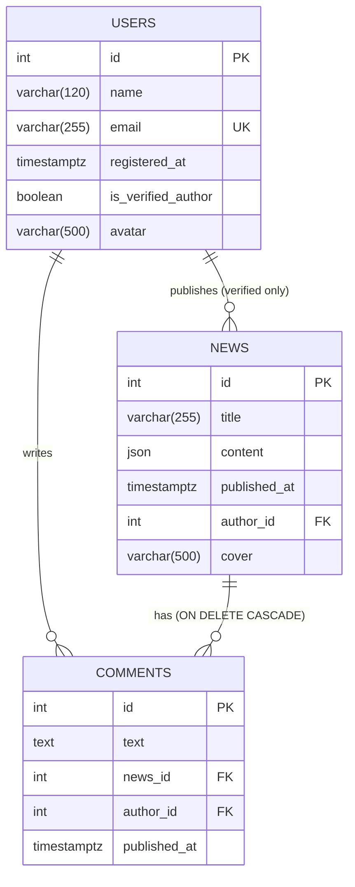

# News Management API (`lab1_Jia_B_Y`)

CRUD API для управления **пользователями**, **новостями** (с поддержкой JSON-контента) и **комментариями**, реализованный на **FastAPI**, **SQLAlchemy 2**, **Alembic** и **PostgreSQL**.

## Стек и требования

- **Python**: `3.10+`
- **Фреймворк**: `FastAPI` + `Uvicorn`
- **ORM и миграции**: `SQLAlchemy`, `Alembic`
- **СУБД**: `PostgreSQL` (`psycopg`)
- **Валидация**: `Pydantic` (`pydantic[email]`, `pydantic-settings`)

Зависимости в [`requirements.txt`](./requirements.txt) сведены к минимуму — только библиотеки, необходимые для работы API и подключения к PostgreSQL.

---

## Архитектура проекта (MVC + Service Layer)

```text
lab1_Jia_B_Y/
├── alembic.ini                       # Конфигурация Alembic
├── docker-compose.yml                # Быстрый запуск PostgreSQL в Docker
├── .env.example                      # Пример переменных окружения
├── requirements.txt                  # Минимальный набор зависимостей
├── migrations/
│   ├── env.py                        # Подключение метаданных ORM и DATABASE_URL
│   └── versions/
│       ├── 0001_create_initial_tables.py   # Миграция 1: создание таблиц и связей
│       └── 0002_seed_mock_data.py          # Миграция 2: наполнение моковыми данными
└── app/
    ├── main.py                       # Точка входа FastAPI, регистрация роутеров
    ├── config.py                     # Настройки приложения из .env
    ├── database.py                   # Engine, SessionLocal, Base, get_db dependency
    ├── models/                       # Model: SQLAlchemy ORM-модели
    │   ├── user.py
    │   ├── news.py
    │   └── comment.py
    ├── schemas/                      # View (DTO): Pydantic-схемы запросов и ответов
    │   ├── user.py
    │   ├── news.py
    │   └── comment.py
    ├── services/                     # Бизнес-логика и работа с сессией БД
    │   ├── user_service.py
    │   ├── news_service.py
    │   └── comment_service.py
    └── controllers/                  # Controller: HTTP-ручки FastAPI
        ├── user_controller.py
        ├── news_controller.py
        └── comment_controller.py
```

### Принцип разделения ответственности

- **`models/`** — описание таблиц, типов колонок, ограничений целостности (`UNIQUE`, `FOREIGN KEY ... ON DELETE CASCADE`) и связей ORM.
- **`schemas/`** — валидация входных данных (включая `EmailStr` и JSON-структуру контента) и сериализация ответов.
- **`services/`** — реализация бизнес-правил: проверка уникальности email (`409 Conflict`), проверка статуса верификации автора перед созданием новости (`403 Forbidden`), проверка существования связанных сущностей (`404 Not Found`), каскадное удаление.
- **`controllers/`** — тонкий HTTP-слой маршрутизации, статусов ответа и инъекции зависимости `Depends(get_db)`.

---

## Проектирование модели данных

### Ключевые решения

1. **Уникальность пользователей**: поле `users.email` имеет уникальный индекс (`UNIQUE`), чтобы исключить дублирование аккаунтов.
2. **Права на публикацию**: флаг `users.is_verified_author` (по умолчанию `false`) проверяется на уровне сервиса при `POST /news` — неавторизованный как автор пользователь получает `403 Forbidden`.
3. **JSON-контент новостей**: поле `news.content` имеет тип `JSON` в PostgreSQL, что позволяет хранить структурированный контент (блоки текста, теги, метаданные).
4. **Каскадное удаление комментариев**: внешние ключи `comments.news_id -> news.id` и `comments.author_id -> users.id` настроены с `ON DELETE CASCADE`, а в ORM-модели `News.comments` заданы `cascade="all, delete-orphan"` и `passive_deletes=True`. При удалении новости все её комментарии автоматически удаляются на уровне СУБД.

### Визуализация моделей и связей (ER-диаграмма)



---

## Миграции (Alembic)

В проекте определены две последовательные миграции:

1. **`0001_create_initial_tables`** — создаёт таблицы `users`, `news`, `comments`, первичный и внешние ключи с `ON DELETE CASCADE`, уникальный индекс `ix_users_email` и индексы для внешних ключей (`ix_news_author_id`, `ix_comments_news_id`, `ix_comments_author_id`). В `downgrade()` выполняется обратное удаление индексов и таблиц.
2. **`0002_seed_mock_data`** — добавляет моковые данные:
   - 3 пользователя (2 верифицированных автора и 1 обычный читатель),
   - 2 новости с JSON-контентом,
   - 3 комментария.
   После вставки явных `id` выполняется синхронизация PostgreSQL-последовательностей (`setval`), чтобы последующие `POST`-запросы не конфликтовали по первичному ключу. В `downgrade()` моковые записи удаляются.

---

## Установка и запуск

### 1. Подготовка окружения

```bash
cp .env.example .env
python3 -m venv .venv
source .venv/bin/activate
pip install -r requirements.txt
```

### 2. Запуск PostgreSQL

**Вариант A — через Docker Compose:**

```bash
docker compose up -d
```

**Вариант B — локально установленный PostgreSQL:**

Создайте пользователя `postgres` с паролем `postgres` и базу `news_api` (или укажите свои параметры в `.env` в переменной `DATABASE_URL`):

```bash
createdb news_api
```

### 3. Применение миграций

```bash
alembic upgrade head
```

Проверить текущую ревизию:

```bash
alembic current
```

### 4. Запуск FastAPI-сервера

```bash
uvicorn app.main:app --reload
```

- API доступен по адресу: `http://127.0.0.1:8000`
- Интерактивная документация Swagger UI: `http://127.0.0.1:8000/docs`

---

## Примеры использования API (`curl`)

Ниже приведён полный сценарий проверки всех ручек и бизнес-правил из ТЗ.

### 0. Проверка состояния сервиса и моковых данных

```bash
curl -s http://127.0.0.1:8000/health
curl -s http://127.0.0.1:8000/users
curl -s http://127.0.0.1:8000/news
curl -s http://127.0.0.1:8000/comments
```

### 1. Создание пользователей (верифицированный автор и обычный пользователь)

```bash
# Верифицированный автор
curl -s -X POST http://127.0.0.1:8000/users \
  -H "Content-Type: application/json" \
  -d '{
    "name": "Елена Автор",
    "email": "elena@example.com",
    "is_verified_author": true,
    "avatar": "https://example.com/avatars/elena.png"
  }'

# Обычный пользователь (не верифицирован как автор)
curl -s -X POST http://127.0.0.1:8000/users \
  -H "Content-Type: application/json" \
  -d '{
    "name": "Дмитрий Читатель",
    "email": "dmitry@example.com",
    "is_verified_author": false,
    "avatar": "https://example.com/avatars/dmitry.png"
  }'
```

### 2. Проверка ограничения: неверифицированный пользователь не может создать новость (`403`)

```bash
curl -i -X POST http://127.0.0.1:8000/news \
  -H "Content-Type: application/json" \
  -d '{
    "title": "Попытка публикации без верификации",
    "content": {"text": "Эта новость не должна создаться"},
    "author_id": 5
  }'
```

### 3. Создание новости от верифицированного автора (`201`)

```bash
curl -s -X POST http://127.0.0.1:8000/news \
  -H "Content-Type: application/json" \
  -d '{
    "title": "Итоги лабораторной работы №1",
    "content": {
      "lead": "Запущен REST API для новостей.",
      "sections": [
        {"heading": "Стек", "body": "FastAPI + SQLAlchemy + Alembic + PostgreSQL"}
      ]
    },
    "author_id": 4,
    "cover": "https://example.com/covers/lab1.png"
  }'
```

### 4. Создание комментария к новости от другого пользователя (`201`)

```bash
curl -s -X POST http://127.0.0.1:8000/comments \
  -H "Content-Type: application/json" \
  -d '{
    "text": "Отличная новость, всё работает!",
    "news_id": 3,
    "author_id": 5
  }'
```

### 5. Изменение новости (`PATCH`)

```bash
curl -s -X PATCH http://127.0.0.1:8000/news/3 \
  -H "Content-Type: application/json" \
  -d '{
    "title": "Итоги лабораторной работы №1 (обновлено)",
    "content": {
      "lead": "Запущен и протестирован REST API для новостей.",
      "updated": true
    }
  }'
```

### 6. Изменение комментария (`PATCH`)

```bash
curl -s -X PATCH http://127.0.0.1:8000/comments/4 \
  -H "Content-Type: application/json" \
  -d '{
    "text": "Обновлённый текст комментария."
  }'
```

### 7. Удаление новости вместе со всеми её комментариями (`204`)

```bash
# Удалить новость
curl -i -X DELETE http://127.0.0.1:8000/news/3

# Проверить, что комментарии этой новости также удалены (вернёт [])
curl -s "http://127.0.0.1:8000/comments?news_id=3"
```

### Дополнительные операции над пользователями и комментариями

```bash
# Обновление пользователя
curl -s -X PATCH http://127.0.0.1:8000/users/5 \
  -H "Content-Type: application/json" \
  -d '{"is_verified_author": true}'

# Удаление комментария и пользователя
curl -i -X DELETE http://127.0.0.1:8000/comments/1
curl -i -X DELETE http://127.0.0.1:8000/users/5
```

---

## Фоновые email-уведомления (Celery + Redis)

В проект добавлена система моковых email-уведомлений на базе **Celery** и **Redis**:

1. **Уведомление о новой новости** (`app.tasks.notifications.send_new_news_notification`):
   - Автоматически ставится в очередь при успешном создании новости (`POST /news`).
   - Отправляет моковое уведомление всем пользователям из PostgreSQL.
2. **Еженедельный воскресный дайджест** (`app.tasks.notifications.send_weekly_digest`):
   - Запускается по расписанию **Celery Beat** каждое воскресенье в `09:00 UTC` (`crontab(hour=9, minute=0, day_of_week="sunday")`).
   - Собирает новости за последние 7 дней и отправляет моковый дайджест всем пользователям.
   - Также доступен ручной запуск через `POST /notifications/digest` и проверка статуса задачи через `GET /notifications/tasks/{task_id}`.
3. **Надёжность и требования ТЗ**:
   - **Ретраи и exponential backoff**: настроены `autoretry_for=(Exception,)`, `retry_backoff=2`, `retry_backoff_max=300`, `retry_jitter=True`, `max_retries=5`.
   - **Graceful shutdown**: включены `task_acks_late=True`, `task_reject_on_worker_lost=True`, `worker_prefetch_multiplier=1`, а также обработчики сигналов `worker_shutting_down` и `worker_shutdown`, которые корректно прерывают цикл рассылки и перепоручают оставшихся пользователей.
   - **Идемпотентность**: перед отправкой каждому пользователю в Redis атомарно создаётся ключ (`SET ... NX EX`) вида `notif:new_news:{news_id}:user:{user_id}` или `notif:weekly_digest:{period}:user:{user_id}` — повторный запуск или ретрай не создаёт дубликатов.
   - **Логирование в файл**: все моковые отправки записываются в файл `logs/notifications.log` (настраивается через `NOTIFICATION_LOG_FILE`).

### Запуск Celery Worker и Celery Beat локально

```bash
# В первом терминале: API
uvicorn app.main:app --reload

# Во втором терминале: Celery Worker
celery -A app.celery_app:celery_app worker --loglevel=info

# В третьем терминале: Celery Beat (воскресный дайджест)
celery -A app.celery_app:celery_app beat --loglevel=info
```

### Запуск всего стека через Docker Compose

```bash
docker compose up -d --build
```

---

## Метрики, логирование и трекинг ошибок (Prometheus + Grafana, ELK, Hawk)

1. **Prometheus и Grafana**:
   - Эндпоинт `/metrics` отдаёт стандартные HTTP-метрики (`http_requests_total`, `http_request_duration_seconds`) и бизнес-/кастомные метрики:
     - `news_created_total`, `news_total` — созданные и текущие новости;
     - `users_registered_total`, `users_total` — зарегистрированные и текущие пользователи;
     - `news_notifications_sent_total`, `news_notifications_skipped_total`, `news_notifications_failed_total` — отправка уведомлений по типам (`new_news`, `weekly_digest`).
   - Эндпоинт `/metrics/json` и файл `logs/metrics.json` сохраняют полный снимок всех метрик в формате JSON.
   - Grafana (`http://localhost:3000`, логин/пароль по умолчанию `admin`/`admin`) автоматически подключает источник данных Prometheus и дашборд `News API Observability`.
2. **Структурированное JSON-логирование (`structlog` + ELK)**:
   - Все HTTP-запросы и ошибки логируются в JSON (`logs/app.log` и stdout) с полями `request_id`, `method`, `path`, `status_code`, `duration_ms`, `client_ip`, `timestamp`, `level`.
   - Logstash читает `logs/app.log`, парсит JSON и отправляет записи в Elasticsearch (`news-api-logs-*`) для поиска и сортировки по полям в Kibana (`http://localhost:5601`).
3. **Hawk Error Tracking (`hawk-python-sdk`)**:
   - Создайте воркспейс и проект на [hawk.so](https://hawk.so) и укажите токен в `.env` (`HAWK_TOKEN=...`).
   - Для проверки отправки ошибки можно вызвать `GET /debug/error`.

---

## Тестирование и E2E (pytest + pytest-asyncio + Playwright)

В проект добавлены модульные/интеграционные тесты и E2E-тест через UI (`/ui`):

- `tests/conftest.py` — фикстуры изолированной БД, `test_user` (верифицированный автор), `reader_user` и `async_client` (`httpx.AsyncClient`).
- `tests/test_api_crud.py` — асинхронные тесты CRUD пользователей, новостей (включая проверку прав и каскадного удаления комментариев), комментариев, статуса задач и хелперов Hawk.
- `tests/test_notifications.py` и `tests/test_observability.py` — тесты Celery/Redis уведомлений, идемпотентности, graceful shutdown, Prometheus/JSON метрик и `structlog` JSON-логов.
- `tests/test_e2e_news_ui.py` — E2E-тест на **Playwright**, проходящий базовый сценарий через UI `/ui`: создание новости → чтение → редактирование → удаление.

### Запуск тестов и проверка покрытия

```bash
# Установка браузера для Playwright (один раз)
playwright install chromium

# Запуск всех тестов с отчётом о покрытии (>= 60%)
pytest --cov=app --cov-report=term-missing

# Отдельный запуск E2E-теста
pytest -m e2e
```
